# Teardown

How to open the unit, with photos of a disassembled one (in `teardown/`).

## Opening the device

You only have to take it apart for the **first** flash: the stock firmware won't accept an ESPHome image over the
air, so that one goes over serial to the main board. After that, updates go over Wi-Fi.

Follow these steps:

1. **Peel the grey rubber off the bottom.** This is easy, but I haven't managed it without ruining the sticky tape,
   so you will likely need a way to reattach it later.

   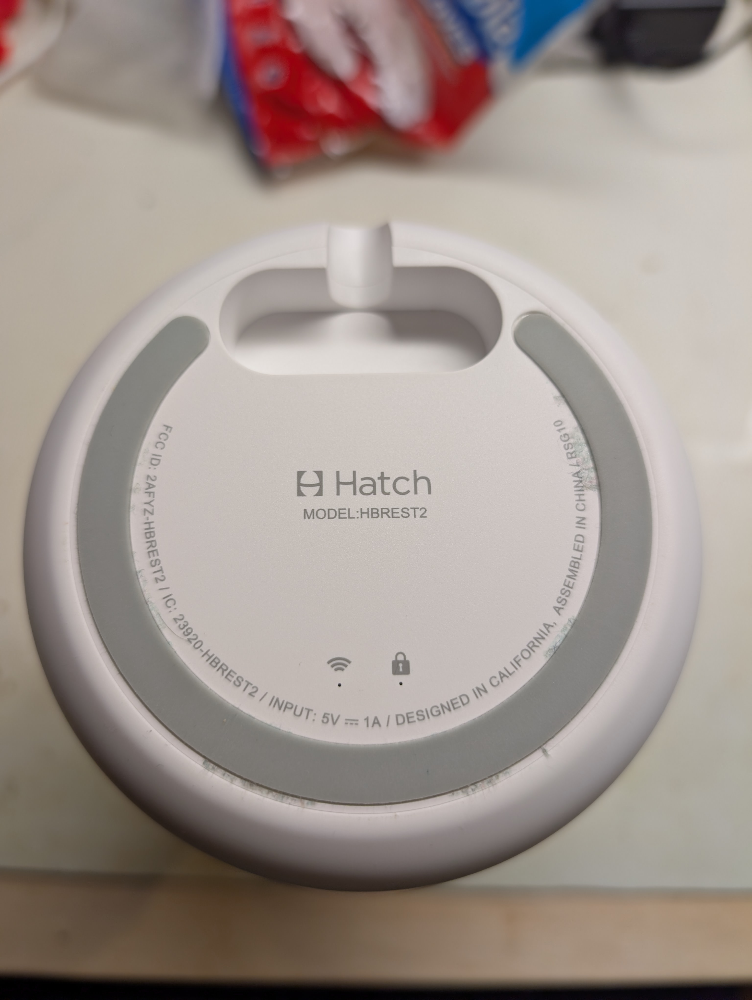 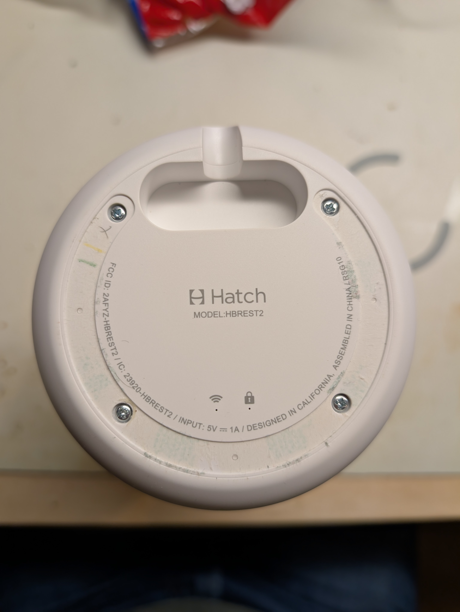
2. **Remove the 4 Phillips screws.** The plastic base then comes off.

   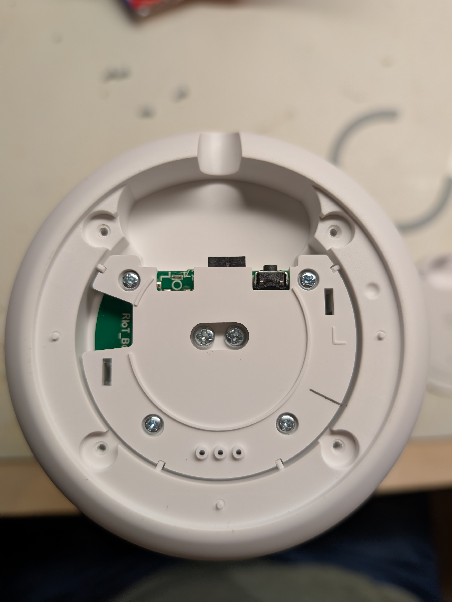
3. **Remove the power daughter board** (silkscreen `RIoT_B…`, "RIoT Base"). Remove the 4 screws holding it and
   gently wiggle it free.

   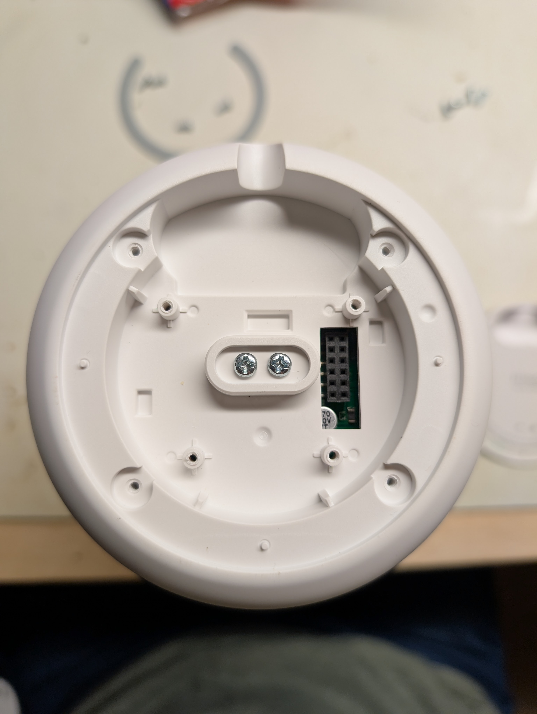 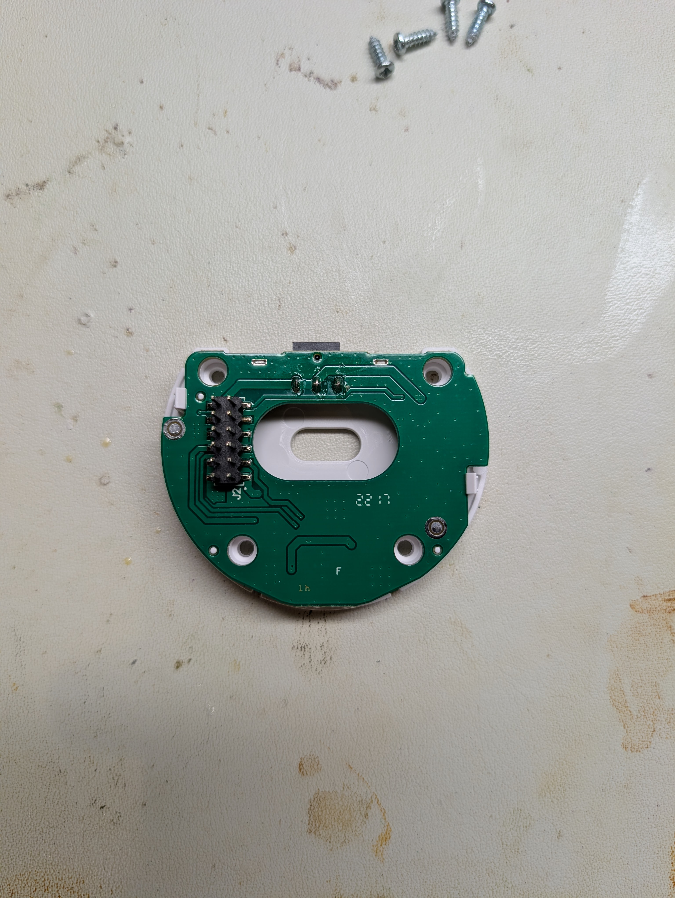
4. **Remove the touch ring and speaker grille.** Turn the device right side up. Insert a pry tool (I used a metal
   one; a small flat-head screwdriver also works) at the outside edge of the touch ring and pry up. It's held by
   very sticky double-sided tape. Be careful: a single wire is attached to the touch ring, and you don't want to
   rip it off.

   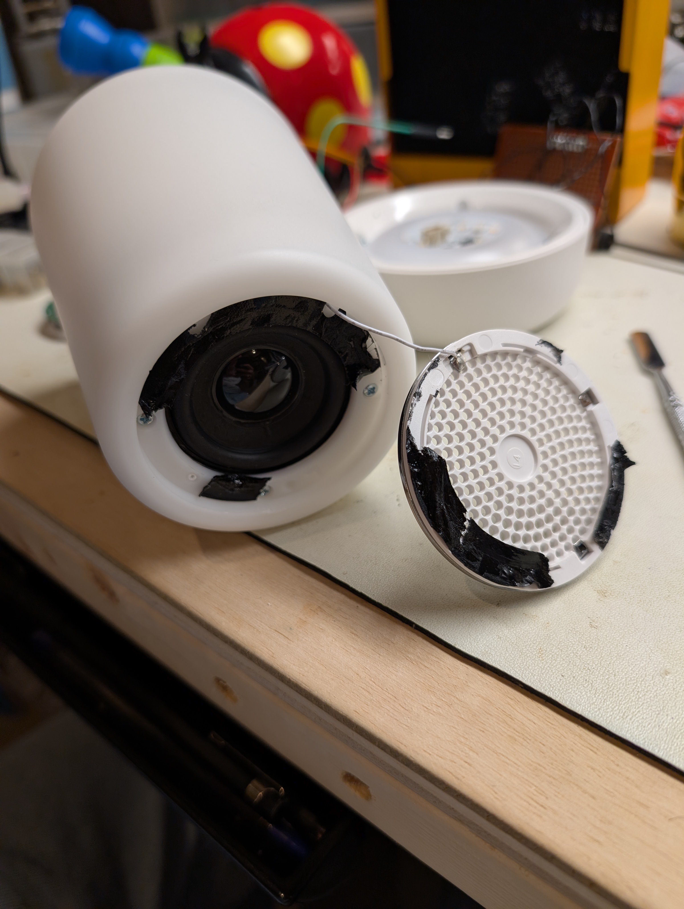
5. **Desolder the touch ring.** Use a soldering iron to disconnect the single wire to the touch ring.
6. **Remove the 4 top screws** (see the step 4 photo). They're under the double-sided tape; keep as much of the tape
   as you can and just expose the screws to remove them. Then gently press on the outside shell to deform it, pop
   it free from the base, pull it up gently and slide it off the touch ring wire.

   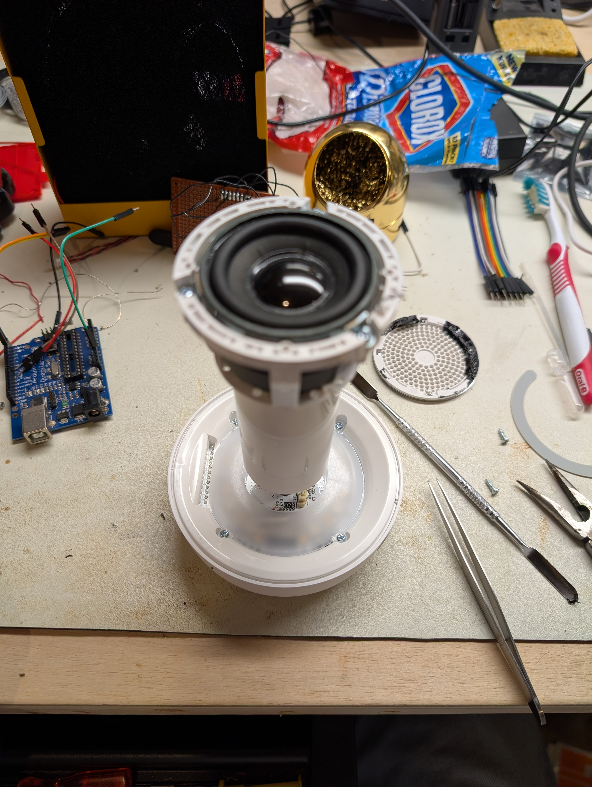
7. **Separate the top from the bottom.** Turn it back over and remove the two large screws in the center. Two sets
   of wires go to the main board through the center post, a 2-pin power connector and a 3-pin JST (red/green/black),
   and they're glued on. Carefully remove the glue, disconnect the wires and separate the two halves.

   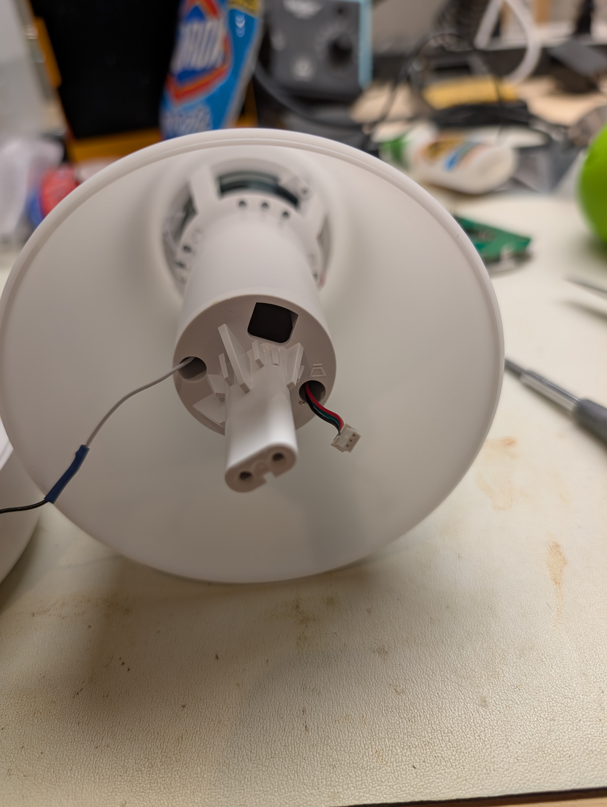
8. **Remove the diffuser.** It's held by 4 screws.

   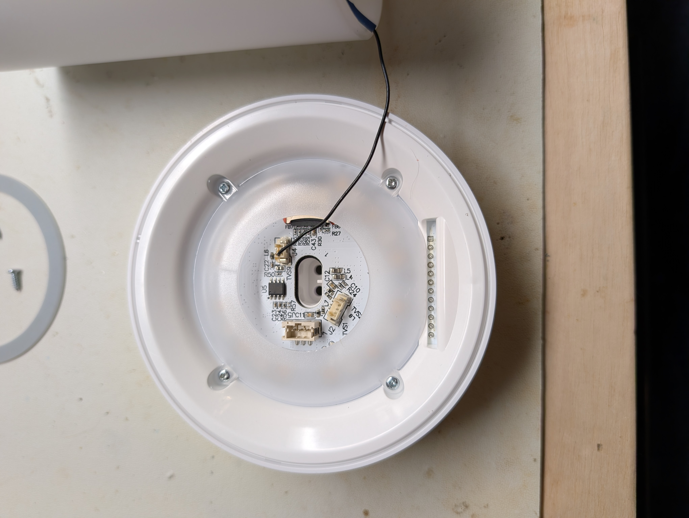
9. **Remove the white inner ring.** Insert a pry tool between the outside edge and the white ring, gently pry up
   and work your way around the edge. That exposes the LED ring board (the removed ring is on the right).

   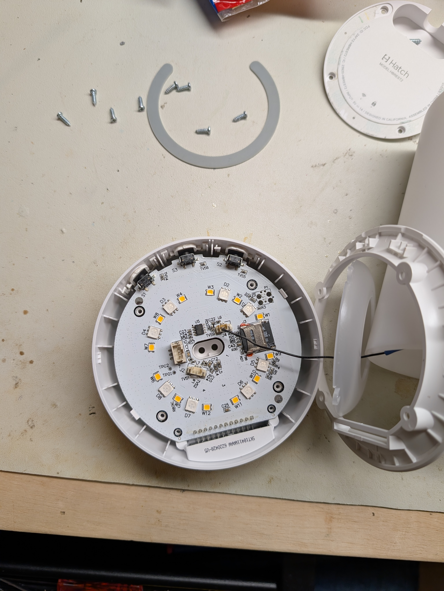
10. **Remove the main board.** While gently pushing up on the black connector on the bottom, push back the retention
    clips holding the main board in.
11. **Done:** the main board is out. Flash it over serial as in
    [esphome-plan.md](esphome-plan.md#safe-flashing-procedure) (back up first).

    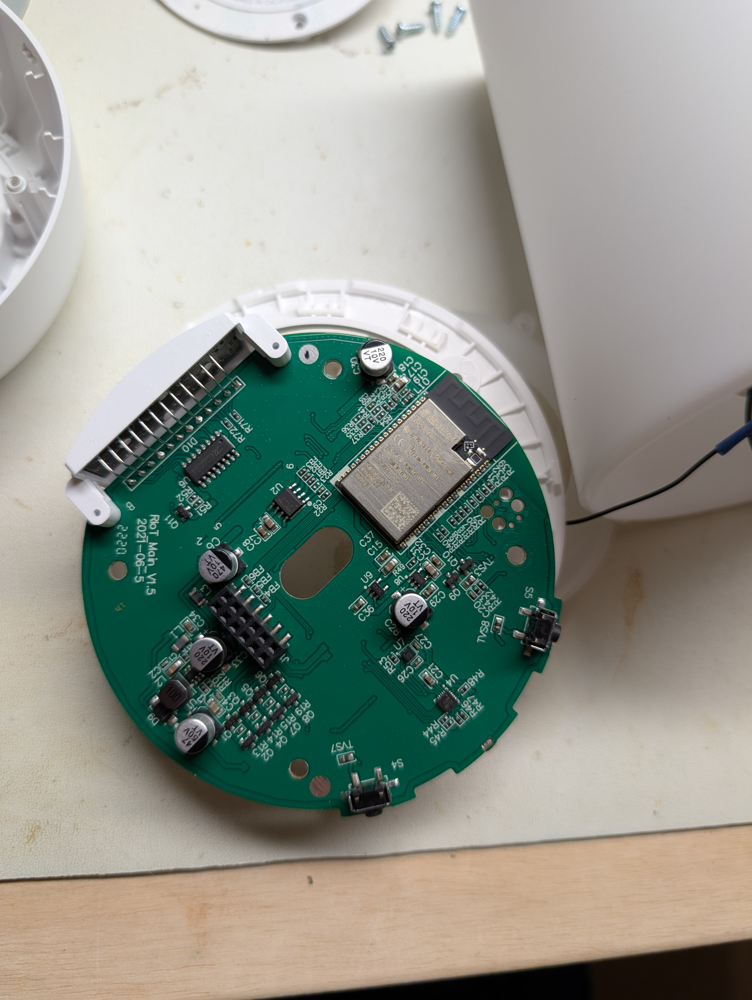

### Reassembly

Reverse the steps. Resolder the touch ring wire before refitting the shell, keeping it clear of the screws, and
re-stick the touch ring and the bottom rubber with fresh double-sided tape where the old tape is spent.

## What the photos confirm

- **Device identity:** model **HBREST2** = Hatch **Rest (2nd gen)**. FCC ID `2AFYZ-HBREST2`, IC `23920-HBREST2`,
  input `5V⎓1A` (step 1 photos). The main board silkscreen reads **"RIoT Main V1.5", dated 2021-06-5**. So the
  firmware's "RIoT" is the Rest 2nd gen.
- **MCU module:** **ESP32-WROVER-E** (printed on the can), the **PCB antenna** variant (serpentine trace at the
  module end, no U.FL connector). Module FCC ID `2AFYZ-ESP32WROVERE`. Flash is **16 MB** (confirmed via
  `esptool flash-id`), so the full part is **ESP32-WROVER-E-N16R8** (16 MB flash, 8 MB PSRAM). See
  [esphome-plan.md](esphome-plan.md#replacing-the-module).
- **LEDs:** a separate LED ring board (marking `SKT1841LWAAW 622042B-U5`, step 9 photo) with **12 RGB LEDs
  (D1–D12) and 12 white LEDs (W1–W12)**. That matches the four LEDC channels in the firmware: R/G/B drive the
  colour LEDs in common, the 4th channel drives the separate whites.
- **Candidate serial/programming header:** a cluster of plated through-holes next to the module on RIoT Main
  (photo 11). Worth metering for UART0 TX/RX, EN, IO0, GND and 3V3 before looking for test points.
- **Not found by photo, resolved on the bus instead:** the accelerometer is a MiraMEMS **DA213** at I2C 0x27 (read
  by its ID), and this (non-Plus) unit has **no GreenPAK** (0x10 absent from the bus scan). See
  [hardware-map.md](hardware-map.md) and [open-questions.md](open-questions.md).
